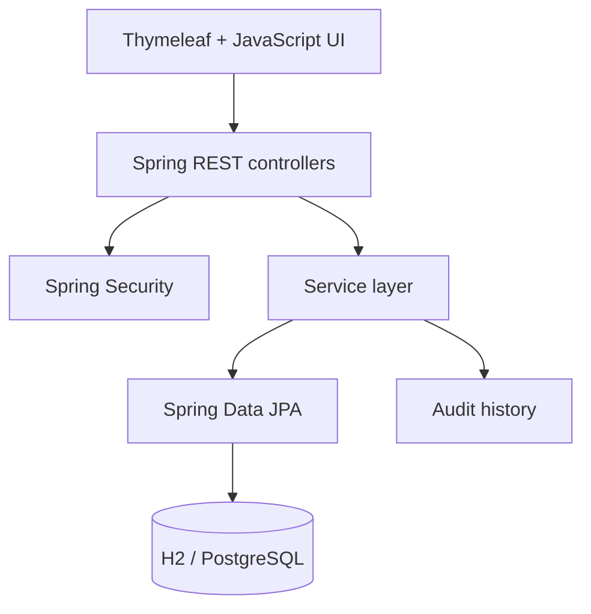

# OpsHub

OpsHub is a full-stack campus operations and incident-management platform. It turns the kinds of reports that disappear into calls, emails, and shift notes into a searchable queue with ownership, permissions, and a permanent audit trail.

   

## Why this project exists

Campus operations teams coordinate access-card failures, facilities problems, technology outages, and guest concerns across several buildings. OpsHub gives staff one clear workflow: report, triage, assign, resolve, and review.

## Features

- Searchable and filterable incident queue
- Live dashboard metrics and critical-incident visibility
- Staff, lead, and administrator roles
- Server-side validation and consistent API errors
- Status workflow with a permanent audit history
- Responsive, accessible interface with CSRF protection
- H2 development mode and PostgreSQL production mode
- Versioned production schema with Flyway
- Unit/API tests and GitHub Actions CI
- Multi-stage Docker image and one-command local stack

## Architecture



The controller layer handles HTTP and validation, the service layer owns business rules and transactions, and repositories isolate persistence. Authentication uses server-managed sessions; method-level authorization protects lead-only workflow actions.

## Run locally

Requirements: Java 17+ and Maven 3.9+.

```bash
mvn spring-boot:run
```

Visit `http://localhost:8080` and use one of the demo accounts:

| Role | Username | Password | Permissions |
|---|---|---|---|
| Staff | `staff` | `demo1234` | View and create reports |
| Lead | `lead` | `demo1234` | Staff permissions + change status |
| Admin | `admin` | `demo1234` | Full workflow access |

Development mode uses an in-memory database and seeds three realistic sample reports.

## Run the production-like stack

```bash
docker compose up --build
```

This starts PostgreSQL, waits for its health check, applies the Flyway migration, and starts OpsHub at `http://localhost:8080`.

## API surface

| Method | Endpoint | Purpose |
|---|---|---|
| `GET` | `/api/dashboard` | Aggregated operations metrics |
| `GET` | `/api/incidents` | Search/filter incidents |
| `GET` | `/api/incidents/{id}` | Incident details |
| `POST` | `/api/incidents` | Validate and create a report |
| `PATCH` | `/api/incidents/{id}/status` | Lead-only status transition |
| `GET` | `/api/incidents/{id}/history` | Audit timeline |

## Tests

```bash
mvn verify
```

The test suite covers authentication, authorization, request validation, business logic, and audit-event creation.

## Before putting this on a résumé

Do not just memorize the feature list. Be able to explain:

1. Why controllers, services, and repositories are separate.
2. How CSRF protection differs from authentication and authorization.
3. Why audit events are separate records instead of a text field on an incident.
4. Why production uses schema migrations rather than `ddl-auto=create`.
5. What happens from a click on **Create report** until PostgreSQL commits the row.

Then add at least one feature yourself. The best next feature is a shift-handoff board with scheduled ownership and overdue-report notifications.

## Honest résumé draft

**OpsHub — Java, Spring Boot, PostgreSQL, JavaScript, Docker**

- Developed a role-based incident-management application with searchable reporting workflows, audit history, and dashboard metrics for multi-building campus operations.
- Designed REST endpoints and a relational persistence layer using Spring Boot, Spring Data JPA, PostgreSQL, validation, and transactional service logic.
- Added automated authorization/API tests, Flyway database migrations, Docker configuration, and a GitHub Actions CI pipeline.

Only use these bullets after you understand the implementation and have made meaningful changes of your own.
